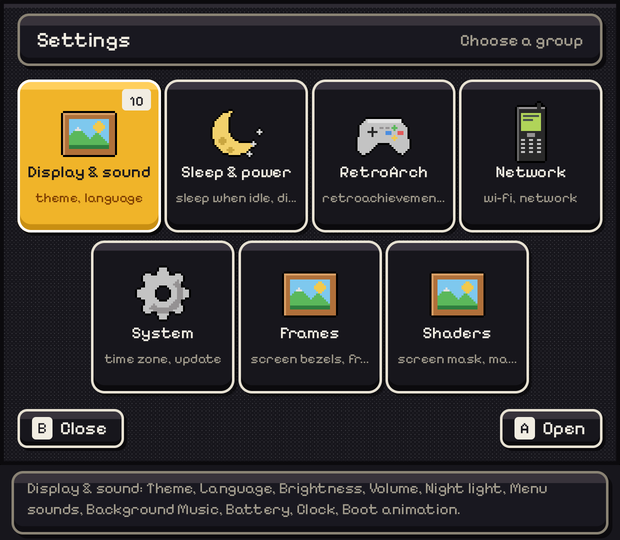
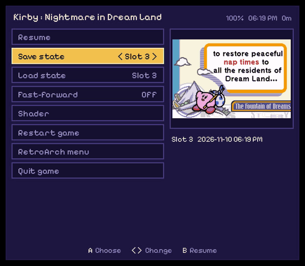
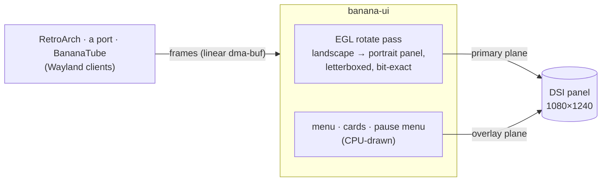

# 🍌 Banana Pocket

*The little operating system for the **Retroid Pocket Classic** — a handheld you can hold in one hand, and a menu you can read from across the room.*

It boots from two A/B slots so an update never touches the system you're running, keeps its games and saves on an
exFAT card, and draws its whole interface **by hand on the CPU**. No systemd, no PulseAudio (the sound server is
PipeWire + WirePlumber). And the menu never lets go of the screen any more: **`banana-ui` is the compositor your
games run in**, so its cards and its own pause menu float above any game, port or video — on a hardware plane of
their own. 🪄

The menu is **Banana's own Pixel UI**: a raised bezel, a carousel of chunky square tiles, a fat gold highlight on
whatever you're about to pick, and a cartridge that drops into a console while your game boots. It comes in five
flavours — `pocket` (gold), `pocket-ocean`, `pocket-sakura`, `pocket-sunset` and `pocket-terminal` — and you can
build your own. 🎨

This repository is **early access**, built from source. Every image CI makes is booted in QEMU and poked at. The
hardware is real, too: the panel timings, the AW88166 amplifiers' PLL, the AudioReach DSP graph and the
power/sleep behaviour were all measured on an actual handheld — [`docs/BOOT-SOUND.md`](docs/BOOT-SOUND.md) is one
such detective story (why the first bit of sound used to take ~20 seconds, and how it became ~8).

## 📸 A look at it

All of these are the handheld's real 1240×1080 panel — grabbed by the QEMU boot test
([`tools/qemu-boot.sh`](tools/qemu-boot.sh)), and the pause menu straight off the device with
[`tools/rpc-screen.sh`](tools/rpc-screen.sh).

| | |
|---|---|
|  | the menu, after the library scan |
|  | the first-time setup: Wi-Fi, time zone, RetroAchievements, box art |
|  | Settings (Start): display & sound, sleep & power, RetroArch, network, system |
|  | System > Update: a package waiting to be written to the other slot |
|  | a Game Boy Advance game, running through RetroArch on the panel |
|  | **new:** the pause menu over a frozen game — slot 3 picked, its save-state screenshot on the right |

## ⏸️ The pause menu

Press the **button under the screen** in any game and it stops — properly frozen, not just muted — under a menu
that speaks Banana instead of RetroArch. Everything you reach for mid-game is one row away; everything else is still
in RetroArch's own menu, one more row down.

| Row | What it does |
|---|---|
| **Resume** | back to the game, exactly where it stopped (**B** or the menu button do it too) |
| **Save state** `< Slot 0–9 >` | pick a slot with ◀ ▶ — the right side shows that slot's screenshot and when it was saved |
| **Load state** `< Slot 0–9 >` | the same picker; asks *Press A again* first, so a stray press can't eat your progress |
| **Change disc** `< Disc 1/2 >` | for multi-disc games (`.m3u`): opens the tray, swaps, closes it |
| **Fast-forward** `On / Off` | flips it without leaving the menu; it kicks in on Resume |
| **Shader** | turns the current shader (LCD grids and friends) on or off |
| **Achievements** `12/40` | your progress, this session's unlocks and the newest badge |
| **Restart game** · **Quit game** | both ask *Press A again* |
| **RetroArch menu** | the full RetroArch menu, for everything else |

The header keeps an eye on the battery, the clock and how long you've been playing. Ports and BananaTube get the
same menu with **Resume** and **Quit** — they freeze too.

| Buttons in a game | |
|---|---|
| menu button | Banana's pause menu |
| menu button **+ X** | RetroArch's own menu |
| menu button **+ Start** | quit straight away |
| menu button **+ L / R** | load / save the current state |
| volume, power | always work — the menu never grabs them |

## 🖼️ One screen, one owner

The handheld's display has one output and two hardware planes. `banana-ui` keeps both for the whole session and
games connect to it over Wayland, exactly as they would to any desktop:



- **The game** goes through one GPU pass that turns it the right way up for the portrait-mounted panel (the plane
  can't rotate in hardware — [measured](docs/PLAN_DRM_COMPOSITOR.md)). Any window size is letterboxed, and the pass
  is **bit-exact**: a 1-pixel LCD grid comes out as a 1-pixel LCD grid.
- **Banana's layer** — volume and brightness, the battery, achievements, the pause menu — sits on the overlay plane.
  When nothing is showing, that plane is switched off entirely.
- **Sleep** keeps the game and its graphics where they were; the panel is re-armed on wake.
- **Escape hatch:** `compositor = "cage"` in `banana/bananad.conf` puts back the old path (games in the `cage` kiosk
  compositor) for one more release.

## 🧩 What runs the show

| Part | What it does |
|---|---|
| `banana-ui` | the menu: the ROCKNIXDS Pixel layout engine on a software backend, KMS dumb buffers, `inotify`-watched ROM folders |
| `banana-ui` (compositor) | the screen's owner while you play: a single-client Wayland server on atomic KMS, the EGL rotate pass, the overlay cards and the pause menu |
| `bananad` | the quiet one: input, sleep, battery, the mixer/volume and jack, the clock and Wi-Fi |
| PipeWire + WirePlumber | the sound server: ACP brings the AudioReach card up from its UCM profile, and the menu and every game/app mix through it |
| `banana-perf` | the clock profiles: `ui`, `powersave`, `balanced`, `performance` |
| RetroArch + cores | the emulators, launched from the library with the menu's settings |

The kernel is ROCKNIX's SM4450 support, trimmed to what the device actually has: no HDMI, no cameras, no Bluetooth,
no FUSE, no swap, no netsched. What's left is the Wi-Fi, the GPU, the AudioReach audio stack, the fan, file sharing
and virtio (so it can run in QEMU).

## 🎮 What it plays

Twenty-one shelves, each with the emulator it needs already in the image — nothing to download, nowhere to sign in.

| | |
|---|---|
| **Nintendo** | Game Boy, Game Boy Color, Game Boy Advance, NES, Super Nintendo, Nintendo 64 |
| **Sega** | Master System, Game Gear, Mega Drive/Genesis, Sega CD, Sega 32X, Dreamcast |
| **Sony** | PlayStation |
| **NEC, SNK** | PC Engine & PC Engine CD, Neo Geo Pocket Color |
| **Atari** | Atari 2600, Atari Lynx |
| **Bandai** | WonderSwan / Color |
| **Computers** | Commodore 64, ZX Spectrum |
| **Ports** | PortMaster |

**RetroAchievements** is baked in: the account from the first-time setup unlocks achievements in-game, and when you
come back to the menu the ones you earned pop up as toasts (with the badge RetroArch fetched), with the system's
running total on the home shelf — and mid-game, the pause menu's **Achievements** row shows how far along you are.
Press **X** on a game for its own options — the emulator and shader *that* game
runs with, and its **save states** to browse, back up or bin.

## 🛠️ Building it

Buildroot does the lot: the toolchain, the kernel, Mesa/freedreno, RetroArch and the cores, the squashfs root and
the SD-card image.

```sh
make retroid-pocket-classic
```

Out comes `output/retroid-pocket-classic/images/banana-retroid-pocket-classic.img.gz` and a matching update package.
Budget an hour or more on a quick machine; CI caches downloads and the compiler cache between runs.

### 🤖 Running it in QEMU

The whole system boots in QEMU's `virt` machine — the card on a PCI SDHCI, a 1240×1080 virtio panel and a serial
console. The boot test drives it through the first boot, a game, an A/B update and a shutdown:

```sh
sh tools/qemu-boot.sh output/retroid-pocket-classic/images/banana-retroid-pocket-classic.img.gz qemu-out
```

Screenshots and logs land in `qemu-out/`. Want to press the buttons yourself? Add `--interactive` for a window
(arrows, Enter = **A**, …).

### 🕹️ Running it on the handheld

Grab the image and the update package from
[the Releases page](https://github.com/jesussaves-ai/Banana-Pocket/releases).

The full walkthrough — the **OpenABL** bootloader, the Android root/unlock dance to install it, writing the card and
the first boot — is in **[`docs/INSTALL.md`](docs/INSTALL.md)**.

In short: write the image to a microSD card (the first three partitions; the data partition is made on first boot):

```sh
zcat banana-retroid-pocket-classic.img.gz | sudo dd of=/dev/mmcblk0 bs=4M status=progress
```

Then pop it in and boot. On the very first start the menu offers a **five-step setup** (Wi-Fi, time zone,
RetroAchievements, box art, Finish); press **B** to skip it and drop straight to the shelf, and it writes
`banana/setup-done` on the card so it won't ask again.

**Updates** show up in `Settings > System > Update` as soon as a `banana-<board>-<version>.update.tar` is copied to
`banana/updates/` on the card (over file sharing, or `ssh "cat > /data/banana/updates/…"`). The package is checked
hash by hash, written to the slot that *isn't* running, and made the default — your current system is never touched,
and **Previous version** flips back if you change your mind.

Over SSH, use `scp -O` (the legacy protocol — dropbear has no SFTP server). A 156 MB squashfs makes a full update
the slow way to iterate, so there's [`tools/push-ui.sh`](tools/push-ui.sh): it cross-builds `banana-ui` with the
image's own toolchain, pushes the ~1.5 MB binary to `/data`, and runs it in the menu's place through a bind-mounted
shim. About a minute instead of a full image. `--revert` (or a reboot) puts the shipped menu back.

## 🗂️ Layout

```
ui/                banana-ui: the menu (rnds engine, software Backend, KMS Display, settings, workers)
                   and the compositor (compositor.cpp, egl_presenter.cpp: Wayland, planes, the rotate pass)
system/bananad/    the daemon and its sleep test
system/rootfs/     the root filesystem: init, rcS, the launchers, the sleep.d hooks
buildroot/         the Buildroot external tree: the board, the kernel fragment, the defconfig
buildroot/board/retroid-pocket-classic/   device trees, the panel, kernel patches, firmware, OpenABL
tools/             qemu-boot.sh, the import script, the benchmark
docs/              the architecture, the roadmap and the hardware notes
```

## 🔬 Measured

Idle in the menu, the menu redraws only when something changes and otherwise sleeps in `poll()`; `bananad` wakes
about once a minute. [`tools/qemu-boot.sh`](tools/qemu-boot.sh) reports memory use, each program's own CPU, and the
CPUs' idle share from inside the VM. The menu's own cost, headless on a PC, is in
[`docs/PERFORMANCE.md`](docs/PERFORMANCE.md) (`make bench`).

Through the compositor, on the handheld:

| | |
|---|---|
| RetroArch on Vulkan, balanced clocks | **60.03 fps**, 0 of 932 frames dropped (under `cage`: 59.91 fps, 13 of 793) |
| Dreamcast (Flycast, GL), 10 minutes | **59.999 fps**, no display errors |
| the rotate pass | **0** pixels different from the game's own frame |
| PlayStation (SwanStation), 10 minutes | 52.0 fps — still open: being compared against the same run under `cage` |

The full trail — the plane probes, the rotation that the hardware refused, every measurement — is in
[`docs/PLAN_DRM_COMPOSITOR.md`](docs/PLAN_DRM_COMPOSITOR.md).

## 📜 License

See [`LICENSE`](LICENSE). The `ui/rnds` engine is imported unchanged from ROCKNIXDS.

## 🎨 Credits

**[Jorre (JorreFog)](https://github.com/JorreFog)** is Banana Pocket's co-developer. Banana grew from his codebase, and
the two projects still share their soul: he keeps his own repo, Tom keeps this one, and fixes travel both ways. A good
part of what you see here started in his hands. Thank you, Jorre.

The system and handheld icons in `ui/assets/rnds/icons` are **[Ben Jelter's Console Icon Pack](https://benjelter.itch.io/console-icon-pack)** — 32×32 pixel art, name-your-own-price on itch.io. Thank you, Ben; they are half the reason the shelf looks like a real handheld OS. The app tiles, generic kind icons and the systems the pack doesn't cover are drawn in-repo (`tools/gen-icons.py`, `tools/make-blueprints.py`).

The Game Boy, Game Boy Color and Game Boy Advance screen bezels are **[SkyWalker541's Retroid Pocket Classic Overlays](https://github.com/SkyWalker541/Retroid-Pocket-Classic-Overlays)**, released under CC0. Three of his `bezel_grid_integer` frames ship unchanged in `system/rootfs/usr/share/banana/overlays`; the grids, shaders and custom art around them are his too. Thank you — they turn a black border into a console.

---

## 🙏 Standing on ROCKNIX's shoulders

Straight up: none of this exists without **[ROCKNIX](https://github.com/ROCKNIX/distribution)**.

They did the hard, unglamorous work of making modern Qualcomm handhelds run real Linux instead of Android — the SM4450 kernel support and device trees, the ADSP/WPSS/ACF firmware and audio topology, the ALSA UCM2 profile this card needs to come up at all, `inputplumber`, the `rnds` menu engine that Banana UI is built on, and a hundred fiddly details you only learn by bricking a thing a few times. I read their tree constantly, borrowed what fit, and the parts of this project that "just work" on this handheld are very often quietly theirs.

If ROCKNIX runs on a device you own — or you just appreciate people dragging open handheld gaming forward — go star the repo, say hi in their Discord, and support them however you can. They've earned it:

**[github.com/ROCKNIX/distribution](https://github.com/ROCKNIX/distribution)** ❤️

---

## 💛 Support

If you'd like to support the project, you can buy me a coffee on Ko-fi:

**[https://ko-fi.com/jesussavesai](https://ko-fi.com/jesussavesai)**

And honestly — paid or free, it all means a lot to me. A donation, a star, a bug report, or just using what I make:
thank you. ❤️
