<p align="center">
  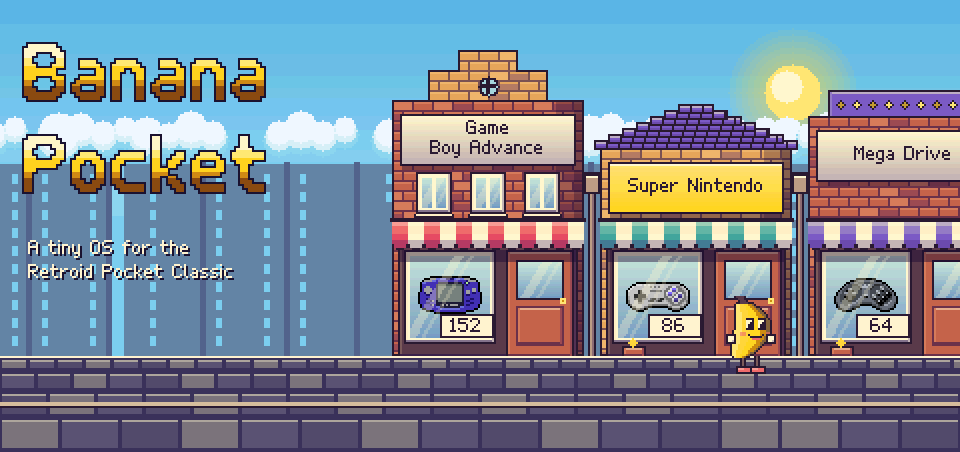
</p>

<p align="center">
  <a href="https://github.com/jesussaves-dev/Banana-Pocket/releases/tag/v0.7.0"></a>
</p>

**Banana Pocket** is the little operating system for the **Retroid Pocket Classic**. Since 0.7 its menu is a street.
Every system is a shop and your games are on its shelves. A banana walks you there.

The whole street follows the rules of a 16-bit Super NES, and the menu draws all of it **by hand on the CPU**. The
system boots from two A/B slots, so an update never touches the one you're running. Games and saves live on an exFAT
card. There's no systemd and no PulseAudio: the sound server is PipeWire with WirePlumber. While you play,
**`banana-ui` is the compositor your games run in**, so its own cards and pause menu sit above any game, port or video.

This is early access, built from source. Every image CI makes is booted in QEMU and tested. The hardware work is
real too: the panel timings, the amplifiers, the DSP graph and the sleep behaviour were measured on an actual
handheld. [`docs/BOOT-SOUND.md`](docs/BOOT-SOUND.md) is one of those stories: why the first sound used to take about
20 seconds, and how it got down to about 8.

## Take a walk

<p align="center">
  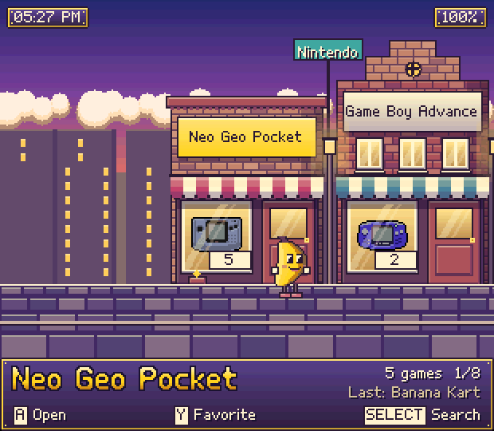
</p>

Left and right walk one shop. **L** and **R** jump to the next maker's block (Nintendo, Sega, Sony and so on), and
each block starts at a street sign. A shop with no games has its shutter down. **A** goes inside, and **A** on a
game starts it in the Super NES's mosaic: the picture breaks into bigger and bigger blocks while the light steps down
in sixteenths.

## Every screen is a place

<table>
  <tr>
    <td width="50%">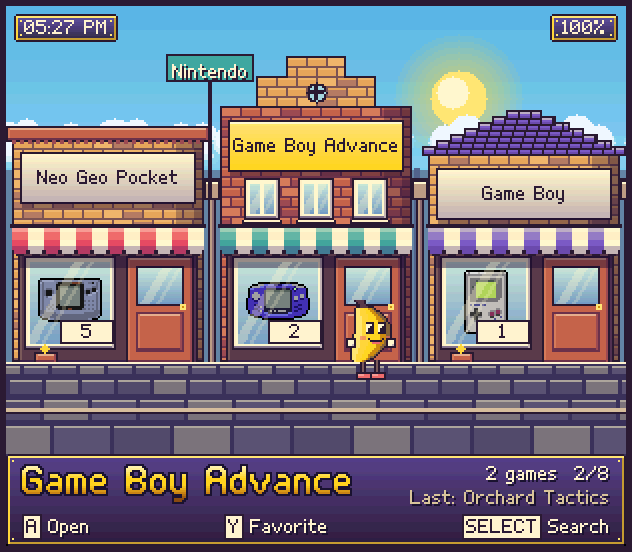</td>
    <td width="50%">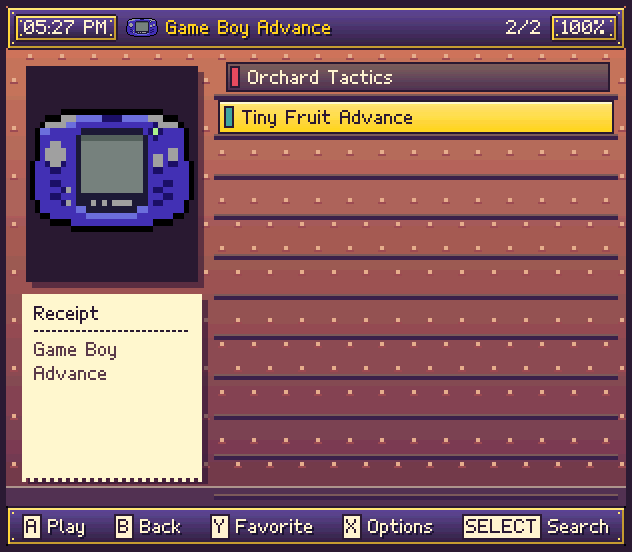</td>
  </tr>
  <tr>
    <td><b>The street</b> is home. The selected shop's sign turns gold, and the panel at the bottom names it, counts
    its games and remembers the last one you played.</td>
    <td><b>The shop</b> is the library. The box sits on the counter, the receipt lists the game's details, and the
    games stand on the shelves.</td>
  </tr>
  <tr>
    <td>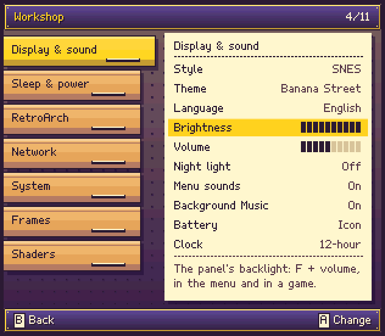</td>
    <td>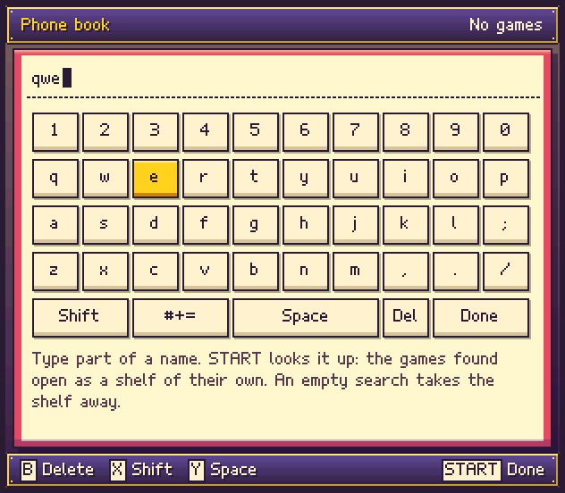</td>
  </tr>
  <tr>
    <td><b>The workshop</b> is Settings (<b>Start</b>). Each group is a drawer, and the open one's settings are on a
    sheet of paper.</td>
    <td><b>The phone book</b> is search (<b>Select</b>). Type part of a name, and the games found open as a shelf of
    their own.</td>
  </tr>
  <tr>
    <td>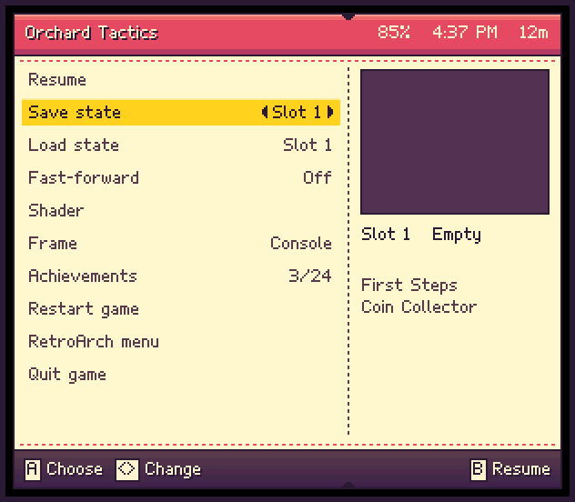</td>
    <td valign="top"><b>The ticket</b> is the pause menu, over a frozen game. The rows are on the stub, and past the
    perforation is the save slot's picture or the game's box.<br><br>Every one of these is a real render of the menu
    at the handheld's resolution, made by <a href="tools/gen-readme-art.py"><code>tools/gen-readme-art.py</code></a>.</td>
  </tr>
</table>

## Built to the Super NES's rules

The look comes from following what that console could actually draw:

- **15-bit colour.** Every colour in the art is snapped to 5 bits a channel.
- **Shading ramps.** Each material (brick, awning, plank, banana) has its own ramp, with purple-shifted shadows and
  warm highlights.
- **Scanline skies.** Gradients step one line at a time, with no dithering.
- **Parallax.** Clouds, the far town and the near rooftops move at their own speeds. The road is cut into bands that
  move faster toward you, which fakes depth without Mode 7.
- **One real pixel grid.** The canvas is 310 × 270, drawn at exactly 4 × 4 panel pixels per art pixel, so every pixel
  is the same size. The text is Banana's own pixel fonts, made for that grid.
- **Mosaic and stepped brightness** for starting a game.

All the art is generated by [`tools/gen-street.py`](tools/gen-street.py). The system icons, names and game counts
stay live, so a new system needs no new art.

## Morning to midnight

<p align="center">
  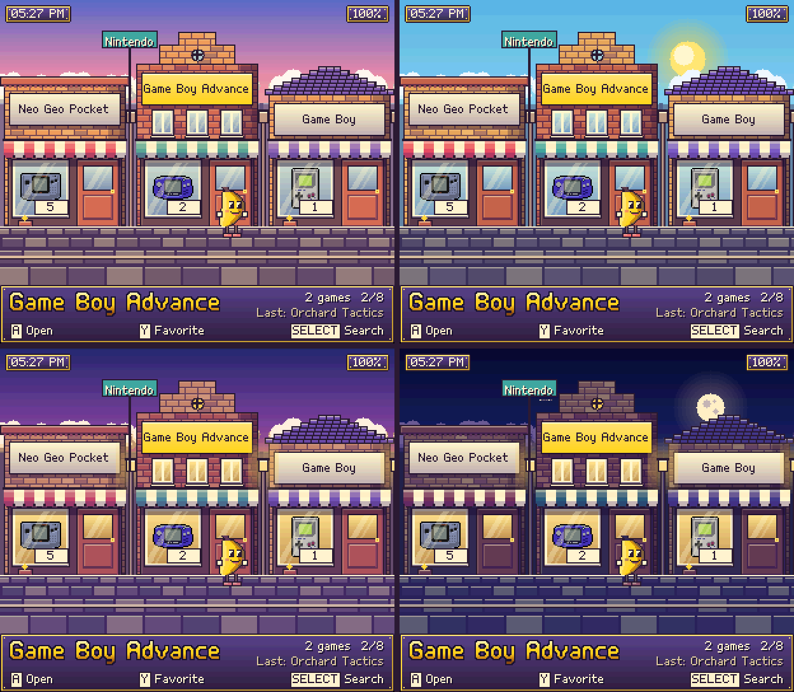
</p>

The street follows the clock: dawn from 5, day from 8, dusk from 17 and night from 20. Windows and lamps come on at
dusk. Night is mostly dark pixels, which is easy on an OLED panel. The scene only changes when the hour does. When
you stand still, the banana's one-pixel bob is the only thing that moves, and **Motion** in Settings turns it off.

## Five neighborhoods

<table>
  <tr>
    <td width="33%">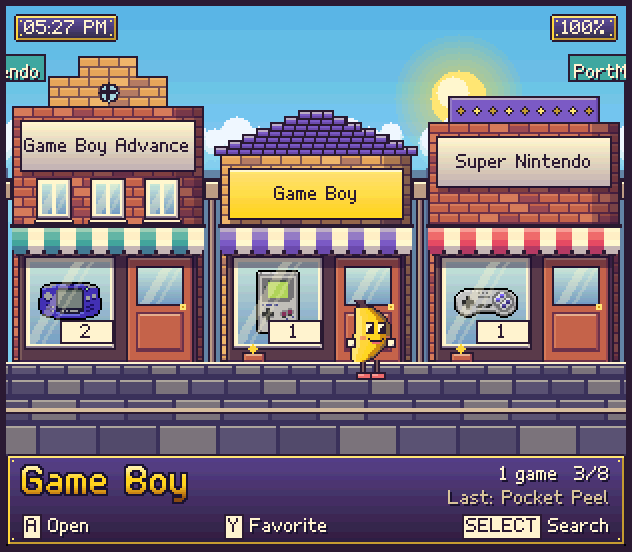</td>
    <td width="33%">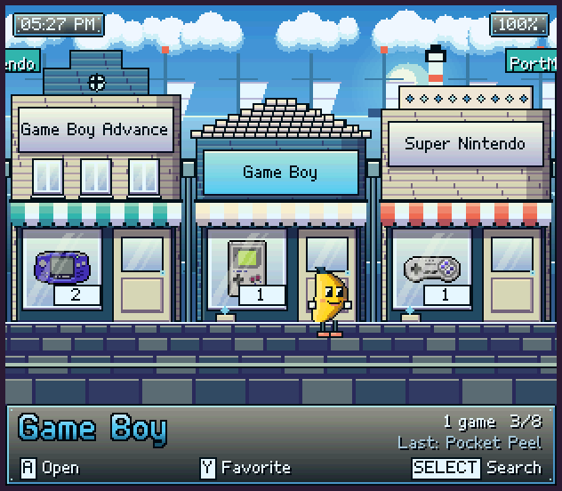</td>
    <td width="33%">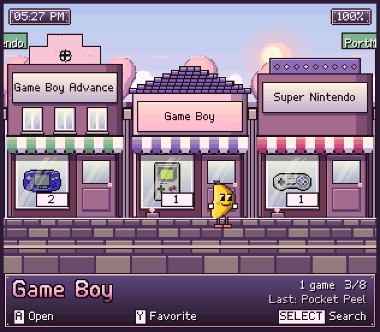</td>
  </tr>
  <tr>
    <td><b>Banana Street</b><br>Warm brick, striped awnings, ripe yellow. The default.</td>
    <td><b>Harbor</b><br>Painted boathouses, the sea and a lighthouse, masts on the quay.</td>
    <td><b>Blossom Row</b><br>Pink plaster under cherry trees.</td>
  </tr>
  <tr>
    <td>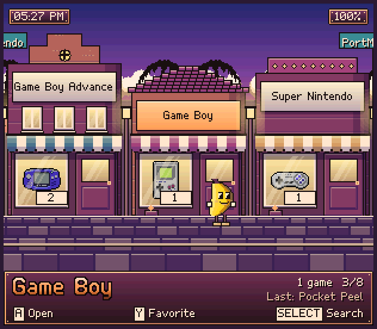</td>
    <td>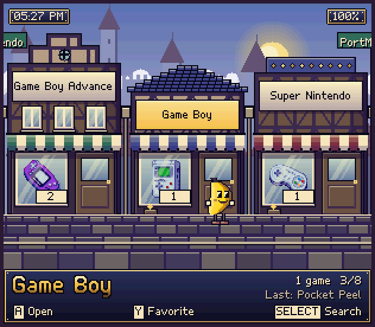</td>
    <td></td>
  </tr>
  <tr>
    <td><b>Sundown Strip</b><br>Always dusk, whatever the clock says. Stucco and palms.</td>
    <td><b>Old Town</b><br>Timber framing below a castle, with the Fantasy icon set.</td>
    <td></td>
  </tr>
</table>

Pick one in **Settings > Display & sound > Theme**.

## Two styles

**Style** sits right above Theme. **SNES** is Banana Street and its neighborhoods, and it's the default on a new card.
**Classic** is the menu from before 0.7: a carousel of chunky tiles with a gold highlight, in `pocket`, `pocket-ocean`,
`pocket-sakura`, `pocket-sunset`, `pocket-terminal`, `fantasy` and six four-shade LCD themes. Each style remembers the
theme you last used in it.

<p align="center"></p>

Themes are JSON, and you can make your own: [`docs/THEMES.md`](docs/THEMES.md) covers both styles.

## The pause menu

Press the **button under the screen** in any game and it stops, properly frozen, under a menu that speaks Banana
instead of RetroArch. Everything you reach for mid-game is one row away, and the rest is in RetroArch's own menu, one
row further down.

| Row | What it does |
|---|---|
| **Resume** | back to the game, exactly where it stopped (**B** or the menu button do it too) |
| **Save state** `< Slot 0–9 >` | pick a slot with ◀ ▶; the right side shows that slot's screenshot and when it was saved |
| **Load state** `< Slot 0–9 >` | the same picker; asks *Press A again* first, so a stray press can't eat your progress |
| **Change disc** `< Disc 1/2 >` | for multi-disc games (`.m3u`): opens the tray, swaps, closes it |
| **Fast-forward** `On / Off` | flips it without leaving the menu; it kicks in on Resume |
| **Shader** | turns the current shader on or off |
| **Frame** `< Console / Banana / None >` | the screen frame around the game, changed at once |
| **Achievements** `12/40` | your progress, this session's unlocks and the newest badge |
| **Restart game** · **Quit game** | both ask *Press A again* |
| **RetroArch menu** | the full RetroArch menu, for everything else |

The header shows the battery, the clock and how long you've played. Ports and BananaTube get the same menu with
**Resume** and **Quit**, and they freeze too.

| Buttons in a game | |
|---|---|
| menu button | Banana's pause menu |
| menu button **+ X** | RetroArch's own menu |
| menu button **+ Start** | quit straight away |
| menu button **+ L / R** | load / save the current state |
| volume, power | always work: the menu never grabs them |

## One screen, one owner

The handheld's display has one output and two hardware planes. `banana-ui` keeps both for the whole session, and
games connect to it over Wayland, exactly as they would to any desktop:

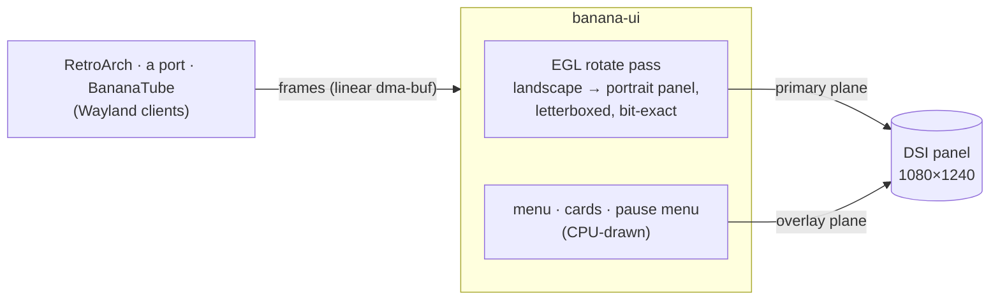

- **The game** goes through one GPU pass that turns it the right way up for the portrait-mounted panel (the plane
  can't rotate in hardware, [measured](docs/PLAN_DRM_COMPOSITOR.md)). Any window size is letterboxed, and the pass is
  **bit-exact**: a 1-pixel LCD grid comes out as a 1-pixel LCD grid.
- **Banana's layer** (volume and brightness, the battery, achievements, the pause menu) sits on the overlay plane.
  When nothing is showing, that plane is switched off entirely.
- **System shaders** (Settings > Shaders) cost the GPU nothing. A CRT, aperture-grille or LCD mask rides on the
  overlay plane, and the panel's own colour matrix gives a Trinitron, PVM or handheld-LCD look, over the menu and
  every game alike. **MODE + Select** turns the mask off for one game.
- **Sleep** keeps the game and its graphics where they were, and the panel is re-armed on wake.

## What runs the show

| Part | What it does |
|---|---|
| `banana-ui` | the menu: a JSON layout engine on a software backend, KMS dumb buffers, `inotify`-watched ROM folders, and the SNES style's own painters for Settings, the keyboard and the pause menu |
| `banana-ui` (compositor) | the screen's owner while you play: a single-client Wayland server on atomic KMS, the EGL rotate pass, the overlay cards and the pause menu |
| `bananad` | the quiet one: input, sleep, battery, the mixer/volume and jack, the clock and Wi-Fi |
| PipeWire + WirePlumber | the sound server: ACP brings the AudioReach card up from its UCM profile, and the menu and every game mix through it |
| `banana-perf` | the clock profiles: `ui`, `powersave`, `balanced`, `performance` |
| RetroArch + cores | the emulators, launched from the library with the menu's settings |

The kernel is ROCKNIX's SM4450 support, trimmed to what the device has: no HDMI, no cameras, no Bluetooth, no FUSE,
no swap, no netsched. What's left is the Wi-Fi, the GPU, the AudioReach audio stack, the fan, file sharing and
virtio (so it can run in QEMU).

## What it plays

Twenty-one shops, each with the emulator it needs already in the image. There's nothing to download and nowhere to
sign in.

| | |
|---|---|
| **Nintendo** | Game Boy, Game Boy Color, Game Boy Advance, NES, Super Nintendo, Nintendo 64 |
| **Sega** | Master System, Game Gear, Mega Drive/Genesis, Sega CD, Sega 32X, Dreamcast |
| **Sony** | PlayStation |
| **NEC, SNK** | PC Engine & PC Engine CD, Neo Geo Pocket Color |
| **Atari** | Atari 2600, Atari Lynx |
| **Bandai** | WonderSwan / Color |
| **Computers** | Commodore 64, ZX Spectrum |
| **Ports** | PortMaster |

**RetroAchievements** is built in. The account from the first-time setup unlocks achievements in-game, and back in
the menu the ones you earned pop up with their badges. Mid-game, the pause menu's **Achievements** row shows how far
along you are. Press **X** on a game for its own options: the emulator and shader that game runs with, and its
**save states** to browse, back up or delete.

## Install

Get the image and the update package from
[the Releases page](https://github.com/jesussaves-dev/Banana-Pocket/releases). The full walkthrough (the **OpenABL**
bootloader, the Android root and unlock to install it, writing the card, the first boot) is in
**[`docs/INSTALL.md`](docs/INSTALL.md)**.

In short, write the image to a microSD card. It holds the first three partitions, and the data partition is made on
the first boot:

```sh
zcat banana-retroid-pocket-classic.img.gz | sudo dd of=/dev/mmcblk0 bs=4M status=progress
```

Then put it in and boot. On the very first start the menu offers a **five-step setup** (Wi-Fi, time zone,
RetroAchievements, box art, Finish). Press **B** to skip it; it writes `banana/setup-done` on the card so it won't
ask again.

**Updates** show up in **Settings > System > Update** as soon as a `banana-<board>-<version>.update.tar` is copied to
`banana/updates/` on the card (over file sharing, or `ssh "cat > /data/banana/updates/…"`). The package is checked
hash by hash, written to the slot that *isn't* running, and made the default. Your current system is never touched,
and **Previous version** flips back if you change your mind. An updated card keeps the style it had; switch to SNES
in **Settings > Display & sound > Style**.

## Building it

Buildroot does the lot: the toolchain, the kernel, Mesa/freedreno, RetroArch and the cores, the squashfs root and
the SD card image.

```sh
make retroid-pocket-classic
```

Out comes `output/retroid-pocket-classic/images/banana-retroid-pocket-classic.img.gz` and a matching update package.
Budget an hour or more on a quick machine. `make test` builds the menu for your computer and checks it headless, and
`tools/check-themes.py` checks every theme and its art.

### Running it in QEMU

The whole system boots in QEMU's `virt` machine, with the card on a PCI SDHCI, a 1240×1080 virtio panel and a serial
console. The boot test drives it through the first boot, a game, an A/B update and a shutdown:

```sh
sh tools/qemu-boot.sh output/retroid-pocket-classic/images/banana-retroid-pocket-classic.img.gz qemu-out
```

Screenshots and logs land in `qemu-out/`. Add `--interactive` for a window you can press buttons in (arrows,
Enter = **A**, …).

### Working on the handheld

Over SSH, use `scp -O` (the legacy protocol: dropbear has no SFTP server). A full update is the slow way to iterate,
so [`tools/push-ui.sh`](tools/push-ui.sh) cross-builds `banana-ui` with the image's own toolchain, pushes the ~1.5 MB
binary to `/data`, and runs it in the menu's place through a bind-mounted shim. That takes about a minute instead of a
full image, and `--revert` (or a reboot) puts the shipped menu back.

## Layout

```
ui/                banana-ui: the menu (rnds engine, software Backend, KMS Display, settings, workers)
                   and the compositor (compositor.cpp, egl_presenter.cpp: Wayland, planes, the rotate pass)
system/bananad/    the daemon and its sleep test
system/rootfs/     the root filesystem: init, rcS, the launchers, the themes and their art
buildroot/         the Buildroot external tree: the board, the kernel fragment, the defconfig
tools/             gen-street.py (the street's art), gen-readme-art.py (these pictures), qemu-boot.sh, the benchmark
docs/              the architecture, the roadmap and the hardware notes
```

## Measured

Idle in the menu, the menu redraws only when something changes and otherwise sleeps in `poll()`. Standing on the
street costs about 4 ms of drawing four times a second for the banana's bob, and nothing with Motion off. `bananad`
wakes about once a minute. The menu's own cost, headless on a PC, is in
[`docs/PERFORMANCE.md`](docs/PERFORMANCE.md) (`make bench`).

Through the compositor, on the handheld:

| | |
|---|---|
| RetroArch on Vulkan, balanced clocks | **60.03 fps**, 0 of 932 frames dropped |
| Dreamcast (Flycast, GL), 10 minutes | **59.999 fps**, no display errors |
| the rotate pass | **0** pixels different from the game's own frame |
| PlayStation (SwanStation) | **60.22 fps** emulated; 1800 of 1800 frames presented, 0 dropped |

The full trail (the plane probes, the rotation the hardware refused, every measurement) is in
[`docs/PLAN_DRM_COMPOSITOR.md`](docs/PLAN_DRM_COMPOSITOR.md).

## License

See [`LICENSE`](LICENSE). Banana's drawing code (`ui/src/raster.cpp`) and the Classic style's theme assets come from
ROCKNIXDS.

## Credits

**[Jorre (JorreFog)](https://github.com/JorreFog)** is Banana Pocket's co-developer. Banana grew from his codebase,
and the two projects still share their soul: he keeps his own repo, Tom keeps this one, and fixes travel both ways.
A good part of what you see here started in his hands. Thank you, Jorre.

The system and handheld icons in `ui/assets/rnds/icons` are **[Ben Jelter's Console Icon Pack](https://benjelter.itch.io/console-icon-pack)**:
32×32 pixel art, name-your-own-price on itch.io. They're what hangs in every shop window. Thank you, Ben. The app
tiles, generic kind icons and the systems the pack doesn't cover are drawn in-repo (`tools/gen-icons.py`,
`tools/make-blueprints.py`).

The street, its neighborhoods, the banana and Banana's pixel fonts are original, generated in-repo by
[`tools/gen-street.py`](tools/gen-street.py) and [`tools/make-pixel-font.py`](tools/make-pixel-font.py).

The Game Boy, Game Boy Color and Game Boy Advance screen bezels are **[SkyWalker541's Retroid Pocket Classic Overlays](https://github.com/SkyWalker541/Retroid-Pocket-Classic-Overlays)**,
released under CC0. Three of his `bezel_grid_integer` frames ship in `system/rootfs/usr/share/banana/overlays`, with
the LCD grid inside the screen cleared. Thank you: they turn a black border into a console.

---

## Standing on ROCKNIX's shoulders

Straight up: none of this exists without **[ROCKNIX](https://github.com/ROCKNIX/distribution)**.

They did the hard, unglamorous work of making modern Qualcomm handhelds run real Linux instead of Android — the SM4450 kernel support and device trees, the ADSP/WPSS/ACF firmware and audio topology, the ALSA UCM2 profile this card needs to come up at all, `inputplumber`, the `rnds` menu engine that Banana UI is built on, and a hundred fiddly details you only learn by bricking a thing a few times. I read their tree constantly, borrowed what fit, and the parts of this project that "just work" on this handheld are very often quietly theirs.

If ROCKNIX runs on a device you own — or you just appreciate people dragging open handheld gaming forward — go star the repo, say hi in their Discord, and support them however you can. They've earned it:

**[github.com/ROCKNIX/distribution](https://github.com/ROCKNIX/distribution)** ❤️

---

## Support

If you'd like to support the project, you can buy me a coffee on Ko-fi:

**[https://ko-fi.com/jesussavesai](https://ko-fi.com/jesussavesai)**

And honestly — paid or free, it all means a lot to me. A donation, a star, a bug report, or just using what I make:
thank you. ❤️
