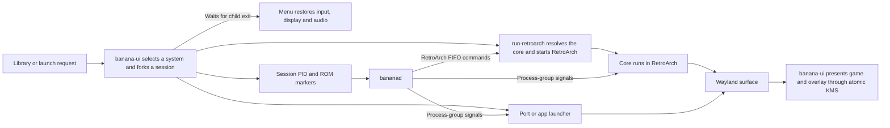
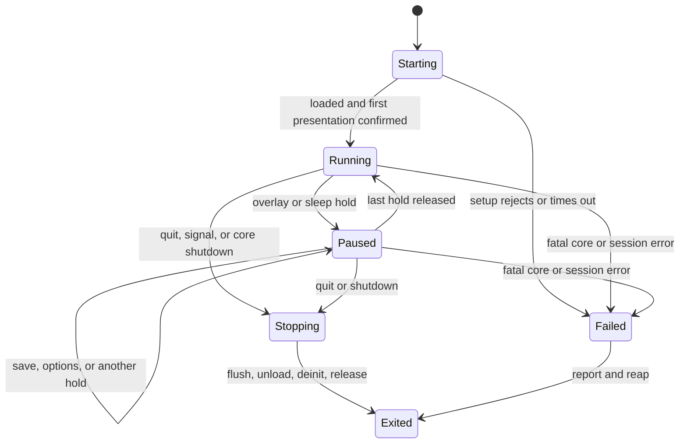

# BananaOS native Libretro runtime

**Status** — Architecture proposal. Implementation, testing, and rollout require separate authorization.

**Source baseline** — BananaOS `dd0382e23afbd942517076f0f7e02838dcfc48d1`, branch `kernel-wake-fixes`.

**Execution plan** — [Ordered Banana tasks](banana-retro-roadmap.md).

**SOURCE** denotes checked-in BananaOS evidence. **UPSTREAM** denotes official documentation or implementation evidence. **PROPOSAL** denotes a design decision for BananaOS. **UNKNOWN** denotes an item that still needs source, runtime, or product validation. A package selected in the defconfig is an inventory item, pending verification of the built manifest.

## A. Existing architecture

### Launch, presentation, and return

**SOURCE** — `banana-ui-session` chooses the persistent systems override and establishes the Wayland runtime environment. `Library` reads system IDs, ROM extensions, run commands, and performance profiles. `runGame` expands shell-quoted `%ROM%` and `%SYSTEM%`, prepares the frame and performance profile, releases menu audio, and forks a new session to run the selected command. It passes `BANANA_ROM`, `BANANA_SYSTEM`, application data, per-game core/shader/frame selection, and achievement integration paths where applicable. The parent publishes `game.pid` and `game.path` and identifies RetroArch by looking for `run-retroarch` in the command. `waitpid(WNOHANG)` drives cleanup, including session markers and menu sound and redraw. `/run/banana/launch` is an external launch entry point. `system/rootfs/usr/bin/banana-ui-session:1–20`, `ui/src/library.cpp:343–378`, `ui/src/main.cpp:1006–1119,1124–1213,1270–1287`.

**SOURCE** — Core selection is per-game installed override, then installed per-system override, then the configured default. The PlayStation wrapper can fall back to PCSX-ReARMed if the selected default SwanStation is absent. Ports use `run-port` and SDL mapping. BananaTube uses a Wayland/ALSA launcher and a separate mpv player. The optional PokeDaisy package has its own SDL host and cores. These application paths can keep their existing process and input contracts. `system/rootfs/usr/libexec/banana/run-retroarch:13–39`, `system/rootfs/etc/banana/systems.conf:185–189`, `system/rootfs/usr/libexec/banana/run-port:10–48`, `system/rootfs/usr/libexec/banana/run-bananatube:21–36`, `buildroot/package/pokedaisy/pokedaisy.mk:7–49`.

**SOURCE** — banana-ui keeps DRM master. Its in-process server exposes xdg-shell, seat, SHM, and linear single-plane XRGB8888/ARGB8888 DMA-BUF. It puts the game on the primary plane and the menu or frame on the overlay. EGL imports DMA-BUF or uploads SHM as a texture, then fits and rotates into linear GBM scanout slots. The direct presenter can import supported client DMA-BUFs and scan them without the EGL rotation pass. EGL can pass a native output fence to KMS when the EGL extension and plane property are available. The existing fallback waits with `glFinish`. KMS permits one in-flight game flip. A transformed source buffer is released after its flip, and a direct-scanout source remains owned until a replacement flip. Frame callbacks can also run after a dropped render or commit. `ui/src/compositor.cpp:155–176,197–266,318–374,427–461,1290–1307,1450–1482`, `ui/src/egl_presenter.cpp:186–228,435–447,604–655`, `ui/src/presenter.cpp:8–44`, `ui/src/kms.cpp:801–871`.

**SOURCE** — The compositor advertises `wl_shm` even when a direct presenter is active, but that presenter ignores SHM attachments. EGL SHM needs BGRA texture support. The RetroArch wrapper selects Turnip Vulkan on SM4450 and GL in the current QEMU path, with exceptions for core-specific API requests. The wrapper documents missed vblanks in the extra Flycast rotate pass and an a613 GMEM penalty for its particular Vulkan configuration. `/run/banana/upright` is a RetroArch-specific pre-rotation signal. These are checked-in observations and policy, pending reproduction under the native host. `ui/src/compositor.cpp:853–872,947–955,1456–1479`, `ui/src/egl_presenter.cpp:435–449`, `system/rootfs/usr/libexec/banana/run-retroarch:205–250`.

**SOURCE** — Game and UI clients open ALSA `default` through PipeWire and WirePlumber. bananad controls hardware gain and the sound service owns DSP routing and readiness. RetroArch uses `alsathread`, a configured 48 ms audio latency, rate control, and video pacing with VSync. The wrapper retries abort code 134 during startup. banana-ui already discovers evdev input through inotify and grabs gamepads at pause, while RetroArch uses libudev-zero with udev joypad profiles. The built-in RPC pad has digital controls and no stick bindings. bananad handles system power, volume, jack, and sleep independently. `system/rootfs/etc/banana/retroarch.cfg:58–82`, `system/rootfs/usr/libexec/banana/run-retroarch:252–262,379–394,470–509`, `system/rootfs/usr/libexec/banana/sound-server:40–57,80–128`, `ui/src/input.cpp:51–154,203–212,230–290`, `ui/src/pause_menu.cpp:149–195`, `system/rootfs/usr/share/libretro/autoconfig/udev/Retroid Pocket Classic Gamepad.cfg:1–42`, `system/bananad/bananad.c:1381–1475,1741–1755,1835–1850,2652–2724`.

### RetroArch dependency map

| Surface | SOURCE dependencies and reusable seams |
| --- | --- |
| Package and launcher | RetroArch v1.22.2, its Wayland/ALSA/udev and video backends, bundled shaders, autoconfig, and Kconfig owning the core menu. Keep core binaries and the generic library/launcher contract. `buildroot/package/retroarch/retroarch.mk:7–61`, `buildroot/package/retroarch/Config.in:1–24`, `buildroot/package/retroarch/cores.in:3–158`, `tools/check-systems.py:123–127`. |
| Runtime configuration | Wrapper maintains `/data/retroarch/retroarch.cfg`, creates core-specific defaults, forces driver settings, applies remaps and shader overrides, handles integer scaling and the frame hole, writes an appended volatile account config, changes HOME/XDG paths, and passes core/ROM/FIFO to RetroArch. Keep existing settings semantics only where needed for runtime selection or migration. `run-retroarch:43–202,205–262,288–354,379–472` under `system/rootfs/usr/libexec/banana/`, `ui/src/settings.cpp:367–370,695–717,820–827`. |
| Pause and controls | Quick menu stops the process tree. It resumes it to consume queued relative slot/disc changes, save/load, fast-forward, reset, menu toggle and quit. Native controls can use absolute commands and capabilities. Generic port/app pause remains useful. `ui/src/main.cpp:747–776,1220–1234`, `ui/src/pause_menu.cpp:149–245`. |
| Power and supervision | bananad writes newline commands to the stdin FIFO. `SAVE_STATE_AUTO` polls a separate result file for up to 1.5 s and skips a stopped game. Suspend uses process-group STOP/CONT, wakes banana-ui to restore display, and can issue or retry `AUDIO_REINIT`. Session recovery uses `/data/banana/resume`. The wrapper watches RetroArch's unload log and escalates TERM/KILL. `rcK` names RetroArch and also stops the game group. Keep supervised child reaping, platform power policies, shutdown bounds, and menu restoration. `system/bananad/bananad.c:322–355,863–926,1038–1078,1168–1197,1248–1337,1741–1755,2652–2724`, `ui/src/main.cpp:1575–1621`, `system/rootfs/usr/libexec/banana/run-retroarch:475–505`, `system/rootfs/etc/init.d/rcK:1–13`. |
| Persistence and optional UX | The shipped config points to BIOS, saves, states, screenshots, and RetroArch options/config/remaps. The menu browses legacy state slots and backups. Achievement progress/unlocks/set, account secrets, Hardcore, RetroArch menu and keyboard, HUD, screenshots, shaders, and cheats have frontend-specific behavior. Keep features that a user depends on reachable through RetroArch until their migration is decided. `system/rootfs/etc/banana/retroarch.cfg:82–108`, `docs/EMULATORS.md:54–63,87–114,120–144`, `ui/src/settings.cpp:2890–3016`, `run-retroarch:395–433`. |
| Downstream patches | `buildroot/patches/retroarch/` covers audio reopen and latency, Wayland/display orientation and widgets, an older DRM fast-forward path, updater contents, analog/D-pad toggle, OSD, autosave and achievement exports. The native design takes responsibility for the applicable behavior through its own interfaces. |

## B. Proposed architecture

### Processes and execution

**PROPOSAL** — Start one `banana-retro` child for each native game. banana-ui owns selection, launch, display, pause/settings UI, process supervision, and return to menu. bananad owns power policy, system hotkeys, hardware volume, and audio readiness. The child owns the loaded core, core options, frame submission, PCM stream, input snapshot, and game persistence. The existing Wayland and process boundaries already support independent clients and preserve menu recovery if a core crashes. Loading cores into banana-ui would put the compositor in the core's failure domain. A long-lived runtime daemon would add cross-game state and supervision.

The runtime main thread owns the core and Wayland client state. It services core calls and control transactions at frame boundaries, and multiplexes event readiness and monotonic deadlines in a blocking poll loop. It handles signal-driven quit through a pollable signal mechanism. Use one audio worker, which alone configures, writes, recovers and closes the PCM. Core-created threads remain subject to the core's ABI contracts. Copy callback data across thread boundaries and reject unsupported threaded callbacks. File writes occur at safe points with explicit bounds on payload size and supervisor deadlines. Add a single bounded persistence worker only if measured checkpoint stalls require it, using immutable snapshots. Preallocate frame and PCM buffers for the negotiated limits outside frame callbacks.

### Core API

**UPSTREAM / PROPOSAL** — Load an installed allowlisted core with `dlopen(RTLD_NOW | RTLD_LOCAL)`, resolve the standard API exports, and check `retro_api_version()`. Install environment, video, sample, batch, input poll, and state callbacks before startup. Initialize, read system info, prepare path or content bytes, load content, query/validate AV info, configure active controller ports, and restore compatible SRAM/RTC before the first run. Honor `need_fullpath` and `block_extract`. Keep paths and memory alive for the applicable contract. Gate the MVP to regular uncompressed files in supported extensions. Unload game only after successful load, deinitialize only after init, and close the library after callbacks and interfaces have been retired. A failure before readiness is a typed launch error. [Official core lifecycle](https://docs.libretro.com/development/cores/developing-cores/) · [Canonical API header](https://github.com/libretro/libretro-common/blob/master/include/libretro.h).

| Interface | PROPOSAL and scope |
| --- | --- |
| Baseline callbacks | `retro_run` once per scheduled core tick. Accept default 0RGB1555, RGB565 and XRGB8888, using per-row pitch and checked sizes. Null video repeats retained content. Provide per-sample and interleaved stereo batch output, and digital RetroPad state plus negotiated bitmask. |
| Environment | Supply stable paths to the system and save directories, a bounded log/message channel, input descriptors, supported device capabilities, video duplication, pixel format, `SET_GEOMETRY`, `SET_SYSTEM_AV_INFO`, `SET_ROTATION`, and core shutdown. Handle timing/geometry changes at a safe boundary and allocate capacity only outside steady-state callbacks. Null or invalid payloads, unsupported operations, and version probes receive the result required by the pinned header. |
| Options and metadata | Implement variables and option definitions v0/v1/v2, including default values, option visibility, and update notification. Register and copy metadata on supported calls, keep returned strings stable for their ABI lifetime, and expose capabilities, current values, and restart semantics to banana-ui. Start with core defaults, with an explicit native override layer. |
| Memory and serialization | Support `RETRO_MEMORY_SAVE_RAM` and `RETRO_MEMORY_RTC` when the core exposes them. Implement reset and size-checked serialization/deserialization as capabilities. Reject unsupported or unsafe serialization modes and validate changing sizes and serialization quirks before claiming support. |
| Optional device and media APIs | Add analog, rumble, keyboard, pointer, no-game/subsystem paths, VFS and disk control only for validated core profiles. Return unsupported for VFS until there is a versioned interface with tested file ownership, seek/read/write and directory semantics. Cores that require the interface stay on RetroArch until then. For multi-disc, negotiate base or extended interface, validate absolute indexes, sequence eject/select/insert, and return the resulting core state on a failed transition. Let vetted cores read `.cue`/`.m3u` sidecars after testing relative paths and traversal policy. |
| Hardware and ancillary APIs | Reject HW negotiation in the software build and fail the selected profile if it requires hardware. Add the GL and Vulkan contracts separately. Core-provided async audio callbacks, achievements/hardcore policy, networking, cheats, microphone, camera, and sensors require their own compatibility decision. |

**PROPOSAL** — Record unknown environment requests once per command, with per-profile startup requirements. Some cores ignore a rejected request and fall back. Others reject load or produce a misleading first frame. Publish readiness only when the selected content, compositor, input, and applicable audio contract are operational. A rejected optional callback alone does not decide compatibility.

### Graphics and timing

**PROPOSAL — Software path.** Use a fullscreen xdg-shell client and two or three reusable SHM buffers with a bounded memory budget. Convert/copy a software frame once into a free XRGB8888 client buffer before the callback returns. Skip conversion if the frame cannot be displayed within the bounded queue. Attach only after the initial configure has been acknowledged. Service the Wayland socket while paused, while an output is stalled, and while waiting for releases. A sent frame is immutable until `wl_buffer.release`. Use the frame callback as queue backpressure, and use compositor flip timestamps for confirmation and measurement. A first-frame acknowledgement comes from a successful KMS presentation for this surface, because the current compositor can acknowledge dropped frames. Define a small versioned Wayland extension for active presenter capability, per-commit game geometry, and first presentation. Bind presentation metadata to the current game surface. Keep aspect, integer fit, frame hole, and panel rotation decisions in banana-ui. Core rotation is relative to the game image and is composed with panel rotation once. See [Wayland protocol](https://wayland.freedesktop.org/docs/html/apa.html).

SHM has predictable ownership and low client setup cost. Its costs are CPU conversion/copy and the compositor upload and rotation/scaling pass. SHM cannot use the current direct presenter. The extension must report actual SHM availability, so a missing extension, failed first flip, or direct-only mode yields a pre-readiness fallback. An EGL software upload client can instead produce a DMA-BUF through Mesa WSI if that path measures better or makes a worthwhile device tier viable. It adds a client upload/texture lifetime and can still require the compositor's rotation pass. A CPU-mapped GBM/DMA-BUF path deserves consideration only after measuring memory coherency, mapping cost, allocatable modifiers, and the actual KMS plane limits.

**PROPOSAL — Hardware paths.** Add EGL/Wayland Mesa WSI for validated GLES and GL profiles. Own the libretro render context, provide proc lookup and the current framebuffer, honor context reset/destroy/cache semantics and bottom-left origin, and handle the HW frame sentinel without reading it as memory. Render to a core target, then present a compositor-compatible Wayland buffer. Treat shader/filter consumption, context loss, and suspend/recreation as explicit lifecycle behavior. Vulkan requires the Libretro Vulkan negotiation/render interfaces, ownership and synchronization of core images and queues, and separately validated Wayland swapchain output. The current compositor consumes compatible Wayland buffers and requires no Vulkan renderer for this client path. Validate actual client buffer imports, producer completion and implicit fence behavior, usage/layout transitions, native output fence support, and scanout release on both paths. User-space optimizations must preserve the existing renderer-to-KMS fence or blocking fallback and the flip/release contract. Probe supported APIs/formats and modifier paths per session before selecting a native profile. Keep pre-rotated scanout a separate optimization with actual capability negotiation and measurements. Keep any Qualcomm tuning scoped to its verified core/driver profile. [Libretro API and hardware interfaces](https://github.com/libretro/libretro-common/tree/master/include).

**PROPOSAL — Clock.** Use an absolute monotonic deadline derived from core FPS as the emulation clock. Keep presentation backpressure independent, and let the display repeat or omit stale frames when rates differ. A late tick may catch up within a small fixed cap, then reset the schedule and count the overrun. Keep running audio and input when presentation stalls, with bounded memory. Suspend or shutdown still interrupt the wait. Discard queued presentation and audio timing on resume, reset, mode change, or confirmed output loss and give the next frame a fresh deadline. In a later fast-forward mode, cap emulation speed, submit the latest useful frame, and mute/discard generated audio with an explicit reset when returning to normal speed. Presenting fewer frames never means suppressing required `retro_run` ticks.

### Audio and input

**PROPOSAL** — Open ALSA `default` with the existing BananaOS routing and keep client gain at unity. Preserve PipeWire/WirePlumber keep-alive and UCM sequencing. The worker drains a bounded SPSC ring. Use ALSA poll descriptors and `snd_pcm_poll_descriptors_revents`, handle short writes, `EINTR`/`EAGAIN`, and distinguish XRUN/suspend recovery from a server disappearance requiring reopen. A bounded timer and sound-readiness event handle reopen outside the core thread, with a visible degraded state on failure. Start with the existing 48 ms requested buffer as a comparison point, log the actual PCM period, delay and occupancy, and keep a small bounded runtime queue. Support a continuous worker-side fractional resampler to the negotiated PCM rate with bounded occupancy correction. Validate quality and drift before lowering latency or adding a resampler library. Count sample acceptance/overflow and underruns. Rebase the controller on reset, pause and resume. [ALSA PCM interface](https://www.alsa-project.org/alsa-doc/alsa-lib/group___p_c_m.html).

**PROPOSAL** — Read evdev directly for gamepads, with inotify hotplug, capability-checked profiles, and stable port assignment. Use the RPC D-pad/hat and buttons as the first profile. Reuse mapping data when formats agree, and leave room for optional external axes and calibrated deadzones. At `input_poll`, drain available events and snapshot devices. `input_state` reads that snapshot and returns neutral for unsupported ports/controls. Process `SYN_DROPPED` with a state query, clear state on remove or ownership change, and require release of held UI/system buttons before feeding the resumed core. Keep power, volume, jack and platform hotkeys in bananad. banana-ui owns the pause action and exclusive gamepad grab while the overlay is interactive. The runtime acknowledges stopping sampling before the handoff and resumes after ungrab and state resync. Reserve MENU and any selected runtime shortcut in one layer to avoid double dispatch. Wayland seat remains useful for focus and later keyboard/pointer support. Treat Linux force feedback as a per-device capability and stop effects at pause, unplug, or quit. Leave the built-in PMIC vibrator with bananad unless a future rumble interface arbitrates it. `system/bananad/bananad.c:2420–2474`. [Linux input event protocol](https://docs.kernel.org/input/event-codes.html).

### Control, supervision, and power

**PROPOSAL** — A session-specific Linux `AF_UNIX/SOCK_SEQPACKET` listener under `/run/banana/retro/<session>/control.sock` lets banana-ui and bananad connect to the one active runtime. The parent publishes an atomically replaced session record with runtime kind, session ID, PID/start time and endpoint. Retain `game.pid`/`game.path` for generic lifecycle consumers. Use a private run directory, restrictive permissions, `SO_PEERCRED` and launch/session checks for local coordination. An installed core runs with the child's process privileges. Dispatch control and core calls on the runtime thread at safe points. Start with one outstanding mutating request across the two clients.

Use explicit byte encoding (version, type, request ID, session ID, flags, length) with bounded messages, no native structs on the wire, and paged option descriptors. Reject bad lengths, unknown versions, truncated packets, or stale sessions. An accepted asynchronous operation may send `ACCEPTED` and must later send a final result with the same ID. In this protocol `OK` means the requested effect completed, including durability where requested. Define stable errors `INVALID`, `UNSUPPORTED`, `BUSY`, `BAD_STATE`, `IO_ERROR`, `CORE_ERROR`, and `STALE_SESSION`. A client-side timeout is ambiguous. Query status before resending a mutation. Deduplicate by live connection/request ID, with reconnect safe only after reconciliation. Use session and power epochs to reject delayed commands. Keep logs free of option secrets and include core, content identity, request ID, and reason.

| Commands | Contract |
| --- | --- |
| `HELLO`, `GET_STATUS` | Negotiate version and expose readiness, core/build identity, paused reasons, option/media capabilities, PCM health, last completed request, and outstanding operation. |
| `PAUSE`, `RESUME` | Acquire or release the caller's hold. Apply at a frame boundary and acknowledge after input/PCM quiescence where required. An overlay hold and a sleep hold coexist. Resume clears input edges, rebases clocks, and reports PCM recovery separately. |
| `FLUSH_SRAM`, `SAVE_STATE(slot)`, `LOAD_STATE(slot)` | Run at a safe point while paused or running. Check sizes and existence, return durable result for writes, and stage validation before changing the core. If a failed unserialize may have partially mutated the core, exit or relaunch with the last valid data. |
| `GET_OPTIONS`, `SET_OPTION(key,value,scope)`, `RESET` | Validate against registered definitions and expose restart requirements. Reset at a frame boundary, preserve SRAM by the selected core policy, and reset timing and input. |
| `PREPARE_SLEEP(epoch)`, `SLEEP_ABORT(epoch)`, `WAKE(epoch)` | bananad acquires a sleep hold, requests the configured checkpoint and PCM quiescence, and receives separate results. On abort or wake, release only that sleep hold after platform restoration. Report degraded audio and retry through existing readiness semantics. |
| `UNLOAD`, `QUIT` | `UNLOAD` performs graceful single-session teardown and then exits, as does `QUIT`. Report completed or failed persistence before exit when possible. The UI treats child reaping as authoritative. `SIGTERM` enters the same graceful path for external shutdown. |

Runtime state machine. `PAUSED` remains responsive for saves, status, and Wayland. Kernel suspend is a platform state outside the child.

At launch, banana-ui keeps a bounded startup watchdog on child readiness. During normal play it reaps on child exit, clears the session identity, detaches presentation safely, returns input ownership and warms menu audio. Automatic fallback is permitted once for a recognized **pre-readiness** failure with no committed native save or state. An active-session crash returns to menu and offers an explicit RetroArch relaunch with save provenance. Use current validated PID/start-time group targeting for TERM and escalation, and account for a UI restart via the inherited control lifetime or session supervisor ownership. Process-group STOP/CONT remains for RetroArch and generic apps, and can serve as a bounded platform fallback when a native runtime fails to quiesce. The supervisor must recover its stopped group and reconcile holds before any IPC retry.

Start with the existing 1.5 s checkpoint/prepare budget and a 3 s graceful exit budget, each with a monotonic deadline and measured adjustments before rollout. A user-requested save timeout gets an explicit error. Suspend proceeds on the current bounded platform policy if a checkpoint fails. Shutdown gives the game a bounded flush, then follows the existing termination and unmount flow. Keep the low-battery sleep refusal, USB transfer interlock, burn-in guard, wake-key swallowing, and display suspend/resume sequence. Confirm `rcK` waits for the tracked native child when powering off directly, including while an overlay is open.

### Persistence and settings

**PROPOSAL** — Read firmware from `/data/bios` and write native data beneath `/data/banana/retro/`. Use a title identity based on normalized system and library-relative content identity, with content digest and core-build identity in metadata for state validation. Build identity comes from packaging or a digest of the installed core, with the reported version as diagnostic metadata. Key memory by title/core family and format schema, and key states additionally by the exact core build and configuration fingerprint where applicable. Multi-disc identity uses the playlist and ordered media identity once supported. Distinguish a moved title, a changed ROM, and two ROMs with the same basename.

Snapshot save RAM and RTC while the core is quiescent at a frame boundary. Atomically replace each datum with a same-directory exclusive temp file, checked writes, `fsync`, close, rename, and directory `fsync` where supported. Publish a generation manifest last for checkpoints that promise a consistent set of SRAM/RTC/state. Keep the previous committed generation available. Use bounds and a checksum to detect corrupt state data on restore. Periodic flush if dirty, explicit save/flush, prepare-sleep, and graceful quit can share the same primitive. Update the resume record only when a validated checkpoint commits, and clear it on a clean menu return according to the existing resume policy. Allow boot resume to select the recorded runtime/core explicitly and handle legacy path-only markers. Validate target exFAT behavior under interrupted writes, full media and attempted remount. Successful rename has atomic visibility. Power-loss guarantees depend on the filesystem and storage.

For cold boot, `bananad` writes `/data/banana/resume` atomically. A RetroArch record keeps the ROM path on line one and adds `banana-legacy-v1 <32 lower-case hex digits>` on line two; each publication gets a new ID, even for the same ROM. The UI also accepts old one-line markers. A native record is unchanged: four newline-terminated lines (`banana-retro-v1`, `system:core` profile, checkpoint manifest SHA-256, absolute ROM path). The digest comes from the authenticated checkpoint or shutdown reply, after the generation and its resume marker are synced. It binds the generation, exact core build, ROM identity, effective options and payload digests. The menu launches a native record only through the matching currently eligible, opted-in profile. The runtime requires that digest to match the verified marker for `CURRENT`; a newer battery commit invalidates older boot records even if a publication was interrupted. Rejected native resumes do not switch runtimes. A normal launch loads battery data rather than retrying a rejected checkpoint.

The `rename` of the staged temp file onto `/data/banana/resume` is the commit point of the outer record, exactly as `CURRENT` is for a checkpoint: it makes the candidate visible to every reader and to the next boot, and only the directory `fsync` after it makes it durable. A failed directory sync therefore does not mean the record is unchanged. `bananad` reports the publication as failed (no proof is acknowledged, and the stamp keeps both the previous and the candidate entry so the visible file is still attributable to a session), while the candidate may already be visible and, after a crash, either record may be the one that survives; durability is unknown, not absent. A retry publishes again under the same lock and rules. The same holds for removal: after a failed directory sync the unlink may be visible, the removal is reported as failed, and nothing treats the old record as still current. Boot validation (exact token and counter attribution) is what makes a visible but unacknowledged record safe to offer.

Removal debt outlives the call that incurred it. An unlink that returned success is durable only after the directory `fsync`, so a failed sync leaves a debt. The UI keeps it per data directory (`resumeSyncDebt()` in `ui/src/app.h`); `bananad` keeps a process-local table of four directory slots (`retro_sync_debt`). Every later removal or invalidation pays the debt first, with a directory sync, before it examines anything, and no other success (a counter written, a later removal) clears it. That includes a retry that finds the marker already absent or published by another session: it returns only after the debt is paid, and it never deletes the foreign or replacement record. The daemon reserves its slot before it unlinks, so a full table refuses the invalidation instead of creating an untracked debt. The debt is not persisted: after a restart of either process the visible record is covered by the boot validation described above, and host tests cannot qualify exFAT durability.

The menu reserves an attempt under the same `resume.lock` the daemon uses to publish and the UI uses to settle. It checks that the selected record is still current and syncs the keyed counter before launching. A replacement has its own three-attempt budget. Cleanup of missing or malformed records happens in the same locked operation as the decision; explicit cancellation and settlement compare identities. A counter that cannot be attributed to a record (damaged, or bare) beside a readable record is treated as a spent budget: planning blocks the launch and clears both, so it neither grants extra attempts nor fails every boot. The UI never waits for a held lock and makes no change when acquisition fails.

Attempt counting is write-ahead. `resumeBegin` rewrites `banana/resume-tries` for the selected record (`tries + 1`) and syncs it before the game is forked, and it refuses once the count reaches `resumeMaxTries` (3), so an attempt that hangs or powers off the device has already been charged. A counted attempt is never refunded: if the fork fails, or the child never proves readiness, the marker and its counter stay for the next boot. Only readiness proof for that session (`resumeConfirm`), a cancel, a rejection (exit 78) or a counter at the budget (planning clears marker and counter together) removes them. A settlement refused because the lock was busy is owed (`stepOwed`) and retried by `ResumeCleanup` for at most `maxAttempts` (20 at 100 ms); it never reports a settlement that was not recorded. The runtime proof is therefore the native session's readiness, bound to the session registration, and never the count or the marker's visibility.

Ownership is by session, not by ROM path. The UI child calls `setsid()`, then atomically writes `/run/banana/game.session` (`v1 <session> <leader pid> <start ticks> <rom>`) before `game.pid`; the UI retires it after reaping the child and before scheduling cleanup (a shutdown keeps it so `bananad` can still prove the session). `bananad` acts for a session only while that registration names a live process-group leader with the same start ticks and `game.pid`; a native session id in a launcher reply must equal the registered session. Publication stamps `/run/banana/resume-owner` (`banana-resume-owner-v1`, previous entry, candidate entry; an entry is `<session|-> <N digest system core rom | L id - - rom>`, and the previous entry may be a bare `-`). Both parsers read the whole stamp: exactly those three lines with every entry well formed, or the visible record is unowned; a damaged entry never lets the other one stand in for it, and two different owners for one key name none. `bananad` refuses to publish a key that is already visible under another session. The stamp is staged before the record rename and re-validated under `resume.lock` together with the shutdown latch, so a reaped or replaced session cannot publish, a periodic publication that began before a shutdown cannot land after it, and an interruption leaves the visible record with its own entry. The stamp lives in `/run`, never outlives a boot, and an old, damaged or unowned record is simply unowned. No code path removes a record by ROM path: a battery-only checkpoint, and a shutdown reply that positively identifies a battery-only commit (OK and no digest, to a request that asked for proof, from the launcher of this ROM), invalidate only a record stamped for their own session. A shutdown reply that does not identify itself that way (a runtime that answered only the compatibility retry, a launcher of another ROM, a digest that does not bind) is ambiguous and removes nothing. A failed publication never removes the previous record and is never acknowledged, but it does not leave the record exactly as it was: a failure after the rename (the directory sync) may already have made the candidate visible, as described above. Either visible record carries its own stamp entry, and the boot exact-token validation rejects a superseded token. A clean return removes the record stamped for the ending session with the counter that names it, plus that launch's boot reservation; a different session's same-ROM checkpoint (same or another profile), an unowned record, and another record's counter survive. A boot reservation attaches to a session only when the boot attempt itself starts the launch, through the explicit call that counted it: the boot resume never travels through the `/run/banana/launch` hook, and any other launch (a menu press, the launch file, an app) lets it lapse unspent, whatever ROM or kind it names, so one game's return never spends another record's attempts.

ROM identity is compared byte for byte. The UI registers the library spelling of the tracked ROM in `game.session` and `game.path`, and `bananad` accepts a checkpoint reply only for that exact spelling. `run-libretro` may be handed an equivalent spelling (symlink, `//`, `.`, `..`); when it resolves to the same file as the registered path, the launcher adopts the registered `game.path` spelling before it publishes the starting session, starts the runtime with it, and names it in the session metadata, so launcher, UI and daemon all compare the same bytes. `game.path` is read as exactly one unmodified line, and resolution is not passed through command substitution alone, so a trailing newline or space never folds two distinct names into one. A launch that does not match the registered game keeps what it was handed and is refused as before.

After a terminal commit (a QUIT or SHUTDOWN that has committed its checkpoint) the native runtime refuses every fresh mutation with a non-OK status: `RESET`, `SET_OPTION`, pause and resume holds, `PREPARE_SLEEP`, `WAKE`, `SLEEP_ABORT`, `SAVE_STATE`, `LOAD_STATE`, `FLUSH_SRAM` and checkpoint. The fence sits in the runtime operation in `system/banana-retro/src/main.c`, behind the control layer's peer authorization and request lookup, so an exact replay of an already answered request (including the QUIT or SHUTDOWN that caused the commit) still returns its cached reply and authorization is unchanged. A fresh request cannot change what the committed checkpoint describes.

Each ended launch leaves exactly one immutable cleanup job naming its session; a job for another session can neither replace nor extend it. While one is pending, a menu press or the `/run/banana/launch` file is held and runs once as soon as the job completes or its window expires (20 attempts at 100 ms inside two seconds; expiry logs and leaves the record for the next boot). A request names its game (system or app id and path) and never a shelf position: a press is taken out of the library's slot when the game is chosen, and it is resolved against the library only when it is admitted, so a rescan, a favourite or a second request cannot make it start another game, and a game that is gone starts nothing. A later press replaces an earlier one that is still held. A press and a launch file that wait together never share a slot: the press goes first, and the file stays on disk unread behind it until the press has started a game or was itself dropped. The launch file is a one-slot mailbox with one consumer. A writer publishes a complete file by rename (a plain write may be taken empty or half-written, and a request taken that way is lost), and a later publication replaces an unread earlier one. The UI consumes it by renaming it to `launch.claim`, then reading and removing that one file, so a replacement published at any later moment is a new request that this consumption never read, moved or deleted; no UI code unlinks the `launch` pathname. A claim left by a UI that died between the rename and the removal is never run; the next claim replaces it. A game's lifetime runs from its admission until the UI reaps it: a request that waited behind the press, or that is visible at the claim the UI makes as the first step after a successful `waitpid` on the tracked child (before teardown, performance commands, history or audio restoration, and before any later pass looks at the path), was made during that lifetime and is discarded by that claim, so a game that exits before the next pass cannot let it start a second game. The cutoff is the atomic claim, not the exact moment the child exited: a request published after it, during teardown included, is a new request. A press that forks no child discards nothing: a game that is gone, a failed fork, and the Store screen (reported as opened, not as a started game) all leave a waiting request eligible. `rcK` and `bananad` create `/run/banana/shutting-down` before any signal and read `game.pid` afterwards; the game's child publishes `game.pid` and only then looks at the latch, and does not execute the game if it sees it, so no group can run that a shutdown did not see. With the latch the UI admits no launch, settles nothing, retires nothing, and halts a pending job, leaving the record and registration to `bananad`'s shutdown publication; every UI mutation (the boot decision at start-up included) looks at the latch only after it holds `resume.lock`, so none can run once the daemon owns the record. Transient failures, including a graceful shutdown from the menu, retain the record. A native attempt consumes it when `run-libretro` publishes `ready` in `/run/banana/native-session`; the UI also checks exact-session readiness on reap and retries settlement if the lock was busy. Without readiness, only exit 78 rejects the record; exit 75, other statuses (including zero) and signals retain it. Cancellation or three counted failures clear the record and counter before another launch. There is no in-session relaunch or RetroArch fallback. Legacy records still settle on a successful fork of their own boot attempt, or at once when their game is not in the library. A session identity is 32 bits of the kernel boot ID, a boot-scoped sequence stored under `/run/banana`, and the UI PID, so a restarted UI cannot reuse a live or stale identity. An already-running game, a pending menu press, an existing `/run/banana/launch` file or a pending cleanup wins over the boot record, which is settled without a second execution. Allocation fails closed on unreadable or malformed boot/counter metadata instead of falling back to a reused value. Compatibility: no record, counter, `CURRENT`/`RESUME` or launcher format changed. Older images ignore the registration, stamp, latch and scheduler. A record resumed from a boot is unowned (it predates this session), so a battery-only checkpoint will not remove it; boot validation still rejects a stale token.

The shutdown latch is serialized with the daemon's publication. A publisher or invalidator checks `/run/banana/shutting-down` and writes the record under `/data/banana/resume.lock`, so `bananad` and `rcK` create the latch under that same lock (`rcK` with `flock -n`, retried for at most 0.2 s; the daemon with its usual bounded acquisition): a writer that already passed its check finishes before the latch exists, and none can write after it. The wait is bounded and never blocks shutdown: if the lock stays held or the card is not mounted, the latch is created without it and the daemon logs that it did. That fallback is the one case where a writer still inside the lock is not ordered by the latch; the record it leaves is stamped for its own session or unowned, and boot validation still rejects a stale token. At shutdown only, the daemon accepts a session leader that is stopped (`T`/`t`) as the owner to capture, because a group stopped by a signal or a checkpoint is still the group it registered; start ticks, process-group leadership, `game.pid` and the registered session are checked exactly as for a live leader, and zombies and dead processes are always refused. Live and suspend publication still require a running leader.

On the UI side, the menu's launch animation counts as a press in flight: file and boot admission wait for it exactly as for a queued press, so a game cannot start in the gap and then drop the press. A boot-record settlement that is refused (the lock was busy, or the latch appeared) is owed rather than forgotten: the UI keeps the obligation, retries it on the main-loop timer inside the same window as cleanup (20 attempts at 100 ms), halts it on the latch leaving the record to `bananad`, and on exhaustion logs that the settlement was not recorded and leaves the record for the next boot. It never reports a settled boot that was not.

New retry files start with `banana-resume-tries-v1`, not a number. Older images therefore read the first ROM-path line of a legacy marker without inheriting a global debt from the new counter. The new UI reads pre-header keyed counters; a bare older count names no record, so planning clears it instead of carrying unattributable debt forward (which also keeps a downgraded menu from blocking a valid legacy record on that count). Older images do not understand the typed native outer marker: they treat its `banana-retro-v1` first line as a ROM path and drop the record. A downgrade therefore loses that automatic native resume offer, not native saves or the exact-token checkpoint verification. No compatibility shim rewrites the record for them.

`CURRENT` is the commit point: the rename that installs it makes the new generation visible to readers, and only the directory `fsync` after that rename makes it durable. A failed directory sync therefore does not mean the record is unchanged. The publication reports failure, but a reader may already see the new `CURRENT` (and its `RESUME` marker), and after a crash either generation may be the one that survives; a failed publication is never acknowledged (no proof or digest is returned) and is never evidence that the old state is still current. Battery and slot loads, slot carry-forward, and checkpoint enumeration ignore generations above a readable `CURRENT`. A later commit removes older unpublished generations and syncs the directory before advancing `CURRENT`, so even a crash immediately after that advance cannot expose them as fallback history. If orphan removal fails, publication is refused. Absent or malformed `CURRENT` still permits newest-valid recovery (including a first-commit orphan); a CURRENT I/O error fails closed. The format is unchanged. Older runtimes can still select an orphan before cleanup and can omit older fallback slots (F3); the downgrade baseline reader is a model, not a shipped-runtime qualification.

Retention still allows up to 30 extra generations for persistently unreadable slots, and ordinary pruning can return early for an unreadable `RESUME`. The slot scan remains capped at 257 candidates. Superseded tokens and unserialize failures can use the full three-attempt budget. Terminal replay after runtime exit, direct `rcK` TERM proof publication, the main-loop redesign, full-path ROM and core-library identity redesign, and physical RPC/exFAT qualification remain deferred.

**SOURCE / UPSTREAM / PROPOSAL** — The shipped configuration sets `/data/saves` and `/data/states` as the parent directories. The emulator guide describes per-core subdirectories and the menu scans both root-level and per-core state layouts. Lookup of legacy battery saves must check actual RetroArch core directory naming, content-derived names, raw SRAM/RTC size/format, and configured overrides. Provide explicit, previewable import, keep existing files intact, and record source and import digest. A valid source is copied into the native namespace before play. Subsequent switches need an explicit copy/export decision for divergent progress. Legacy states need validated RetroArch container/compression extraction, identical core build/content and compatible options, and a disposable core test for unserialize. Keep legacy state import disabled until there are fixtures. Existing aliases, backup files and screenshots remain accessible via the old UI/runtime. `system/rootfs/etc/banana/retroarch.cfg:86–94`, `docs/EMULATORS.md:54–63,87–102`, `ui/src/settings.cpp:2890–2936,2984–3016`. [RetroArch v1.22.2 save task implementation](https://github.com/libretro/RetroArch/blob/v1.22.2/tasks/task_save.c).

**PROPOSAL** — Use the installed defaults under `/etc/banana/retro/` and bounded, versioned INI-style config under `/data/banana/retro/` for native core and game options. Precedence is built-in core defaults, BananaOS profile, per-core options, then per-game options. Persist scoped edits atomically and surface invalid settings or restart requirements. Keep runtime selection distinct from core selection. Resolve the core first, then use the most specific eligible native rule (game, system+core, core, system, global). Missing selections and unsupported feature combinations use normal RetroArch policy. Preserve user systems commands and native-ineligible choices such as selected RetroArch shaders, configured achievements/hardcore, or unsupported content or inputs. Keep existing options and account config authoritative for active RetroArch sessions.

## C. Implementation structure

| Proposed path | Responsibility and boundaries |
| --- | --- |
| `system/banana-retro/include/libretro.h` | Version-pinned upstream ABI header with the MIT notice and provenance. |
| `system/banana-retro/src/main.c`, `core.[ch]` | C99 POSIX executable, narrow internal core open/load/step/unload API, callbacks, CLI and stable exit reasons. |
| `system/banana-retro/src/video_wayland.[ch]`, `audio_alsa.[ch]`, `input_evdev.[ch]` | Frame ownership and submission, audio queue/worker, gamepad snapshots. Standalone host fixtures can supply alternate test backends at build time. |
| `system/banana-retro/src/control.[ch]`, `saves.[ch]`, `options.[ch]` | Byte protocol, persistence, and option snapshots. Add these files when their feature lands. |
| `system/bananad/include/banana-retro-control.h` | Shared native-control wire header for bananad, banana-retro, and banana-ui. The bananad package stages it at `$(STAGING_DIR)/usr/include/`; the banana-retro and banana-ui recipes depend on bananad and build against the staged copy. Standalone builds use the in-tree path. |
| `system/banana-retro/protocol/`, `ui/src/compositor.cpp`, `ui/Makefile` | Versioned Wayland extension and native-surface integration using the existing game primary and overlay paths. |
| `system/banana-retro/Makefile`, `buildroot/package/banana-retro/` | Portable host fixture build and target package build, host wayland-scanner for XML, target libwayland-client and ALSA, POSIX threads and dynamic loader. Stage `/usr/bin/banana-retro` and `/etc/banana/retro/`. |
| `system/rootfs/usr/libexec/banana/run-libretro`, `ui/src/main.cpp`, `ui/src/pause_menu.cpp`, `system/bananad/bananad.c` | Optional dispatcher, integration with current launch and pause, and power/status clients. Use exec and literal arguments for the native child. Existing `run-retroarch` stays the fallback. |

**SOURCE / PROPOSAL** — Buildroot uses a `BR2_EXTERNAL` tree and local generic packages with target compiler and host pkg-config/scanner, and the root Makefile explicitly tracks local-source rebuilds. Add the opt-in package with equivalent rebuild tracking. Initially reuse binaries from `/usr/lib/libretro` and retain current selectors and package dependencies. Before RetroArch becomes removable, lift the core menu out of the frontend's Kconfig, preserve actual core requirements and licenses, and separately audit shared libraries used by banana-ui, PipeWire, ports, and standalone apps. Board profiles supply device mapping and capability policies. Runtime probes select available SHM/graphics, PCM and input capabilities. No proprietary board constants are required for the initial host. `Makefile:16–32,58–74`, `buildroot/external.mk:1`, `buildroot/Config.in:1–11`, `buildroot/package/banana-ui/banana-ui.mk:7–20`, `buildroot/configs/banana_retroid_pocket_classic_defconfig:57–118`.

**UPSTREAM / PROPOSAL** — Reuse the MIT API header and retain its notice. Use official sample cores as contract references or fixtures after reviewing their individual licenses. MinUI's documented command-line host and RGB565 handheld path guide the software prototype. Its repository terms lack a clear general-purpose license for importing implementation. Ludo documents a Go, GLFW, desktop GL and OpenAL stack under GPLv3. RetroArch's GPLv3 runloop provides lifecycle and capability reference. Write BananaOS-specific code under the repository's MIT terms. Retain per-core license/source/notice obligations when distributing the independent host and core packages. Verify chosen source revisions and Buildroot legal manifest before release. `LICENSE:1–21`, `README.md:336–337`. [Official sample cores](https://github.com/libretro/libretro-samples) · [MinUI PAKS](https://github.com/shauninman/MinUI/blob/main/PAKS.md) · [MinUI repository](https://github.com/shauninman/MinUI) · [Ludo](https://github.com/libretro/ludo) · [RetroArch license](https://github.com/libretro/RetroArch/blob/v1.22.2/COPYING) · [RetroArch runloop](https://github.com/libretro/RetroArch/blob/v1.22.2/runloop.c).

## D. Compatibility and migration

**SOURCE** — This inventory describes the RPC baseline's configured core packages and shelves. Each group needs a pinned-binary/content test before becoming native. Render classes marked **PROPOSAL** are candidate paths. Specific environment requirements outside the three pinned source checks are **UNKNOWN**. `buildroot/package/retroarch/cores.in:3–155`, `buildroot/configs/banana_retroid_pocket_classic_defconfig:57–60,165–166`, `system/rootfs/etc/banana/systems.conf:17–181`.

| Systems | Configured default and alternatives | Capability gate and route |
| --- | --- | --- |
| GBA | gpSP, with mGBA | MVP candidate mGBA on standalone uncompressed GBA ROM. Validate options, frame format, SRAM/RTC and timing. gpSP, the default, needs its own dynarec/BIOS/save qualification before native defaulting. |
| GB/GBC | Gambatte, with SameBoy | MVP candidate Gambatte. Pinned source negotiates RGB565 or XRGB8888 and rejects failure, can return duplicate video, supports optional boot ROM, SRAM and RTC. SameBoy is a separate profile. |
| NES/Famicom | FCEUmm, with Nestopia | MVP candidate FCEUmm for cartridge content. Pinned source probes formats and exposes options. Gate FDS, light-gun/keyboard and other specialty content separately. |
| SNES | Snes9x, with bsnes | Later software candidates. Validate special chips, ROM formats, per-core timing, overscan and controller extensions. |
| Mega Drive, 32X | PicoDrive, with Genesis Plus GX where applicable | Later software. Keep 32X tied to its validated PicoDrive profile. |
| Mega CD, Master System, Game Gear | Genesis Plus GX | Later software. CD needs BIOS, fullpath/media-set checks and persistent memory. |
| PC Engine and CD | Beetle PCE Fast (`mednafen_pce_fast`) | Later software with optional CD profile. Validate the system card BIOS, path/archive policy, geometry and disc controls needed by the profile. |
| Atari 2600, Neo Geo Pocket, WonderSwan, Lynx | Stella 2014, Beetle NGP, Beetle WonderSwan, Handy | Later software. Check control layout, WonderSwan rotation, and Handy BIOS. |
| PlayStation | SwanStation, with PCSX-ReARMed | Source config selects the Vulkan SwanStation path. PCSX-ReARMed is a later software candidate, with pinned plugin/ABI verification. Both need validated BIOS/disk/memory-card/state behavior for their respective profiles. |
| Nintendo 64 | Mupen64Plus-Next, with ParaLLEl N64 | Packages enable GLES paths. Exact renderer/plugin ABI and analog behavior need verification. Test a GLES profile before any Vulkan/plugin add-on. |
| Dreamcast | Flycast | Package flags compile GLES3 and Vulkan despite an earlier comment mentioning GLES only. Active RetroArch policy is Vulkan/Turnip on RPC. Validate both API profiles, BIOS/HLE, controls and actual buffer/synchronization costs before migration. |
| Commodore 64, ZX Spectrum | VICE x64, Fuse | Shipped configuration relies on keyboard functionality and tape/disk input. Add native keyboard/media handling or keep these profiles on RetroArch. Fuse clone models require BIOS files. |
| PICO-8 | Fake-08 package | Explicitly disabled in this RPC defconfig. |

**UPSTREAM** — BananaOS pins mGBA at `7a12d6d`, Gambatte at `d9d6cd0`, and FCEUmm at `7a542da`. mGBA's pinned code selects formats by build flags, reports core FPS and sample rate, and exposes persistent memory. These code paths support choosing the initial trial cores. Actual target build flags, mandatory probes and optional behaviors still need a trace of the packaged core with the host. Local hardware profile evidence is in `buildroot/package/libretro-flycast/libretro-flycast.mk:26–38`, `buildroot/package/libretro-mupen64plus-next/libretro-mupen64plus-next.mk:13–17`, `buildroot/package/libretro-parallel-n64/libretro-parallel-n64.mk:14–22`, and `system/rootfs/usr/libexec/banana/run-retroarch:67–94`. [Pinned mGBA adapter](https://raw.githubusercontent.com/libretro/mgba/7a12d6d4b9acb14c0ae62c9166b6a2f3d08007f6/src/platform/libretro/libretro.c) · [Pinned Gambatte adapter](https://raw.githubusercontent.com/libretro/gambatte-libretro/d9d6cd06382d1ced30de34d56d3609452323dab1/libgambatte/libretro/libretro.cpp) · [Pinned FCEUmm adapter](https://raw.githubusercontent.com/libretro/libretro-fceumm/7a542dab1e87679921962a9f056186eca425c0c2/src/drivers/libretro/libretro.c).

**UNKNOWN** — This baseline builds one RPC target and selects the Classic Rev Q DTS. The tree also contains a Pocket Classic 6 Rev Q DTS that includes the same board description. Treat RP6 as a separate portability target until its identity, build profile, display/DRM format and sync support, firmware, input mapping, and power behavior are confirmed. `Makefile:20–24`, `buildroot/configs/banana_retroid_pocket_classic_defconfig:37–38`, `buildroot/board/retroid-pocket-classic/dts/qcom/sm4450-retroid-pocket-classic-6-revq.dts:8–15`. A full built core/binary manifest and a trace of required environment calls for each selected profile also remain open.

| Priority | PROPOSAL |
| --- | --- |
| MVP opt-in | Digital pad, software video, aspect and integer fit, ALSA PCM, core option defaults and scoped values, SRAM/RTC, explicit states for capable cores, native pause/quit/reset, bounded sleep/shutdown, input and crash recovery, basic timing counters. |
| Later | Quick resume and validated legacy migration, capped fast-forward, more cores and archive handling, extended device mappings, keyboard, disc switching, rumble, GL/GLES, Vulkan, and selected filters or shaders where measurements permit. |
| Optional | Rewind, run-ahead, user-controlled frame skipping, advanced shader chains, achievements, rich telemetry and native keyboard UI. Require a concrete compatibility or UX win and a performance budget. BFI is excluded by repository policy. |

## E. Performance and verification

**PROPOSAL** — The architectural gains to measure are fewer frontend features on the game hot path, native pause and saves that bypass FIFO/log polling, bounded client frame ownership, and targeted startup/cadence policies. SHM can cost more CPU and bandwidth than RetroArch's GPU path, especially with RGB conversion and uploads. EGL transformation can consume the available GPU/vblank budget even without a CPU copy. SRAM/state writes, PCM/plugin wakeups, evdev contention, CPU governor effects, and dynamic core timing can dominate any frontend savings.

| Measure | Method and decision gate |
| --- | --- |
| Frame and audio budgets | Measure `retro_run`, callback copy/convert, SHM upload or WSI submit, compositor GPU fence and flip, CPU/thread usage, memory, audio occupancy/delay, underruns and recovery. Use existing `/run/banana/3f-trace` for compositor traces and bounded runtime counters. Count p50/p95/p99 frame intervals, missed vblanks, dropped submissions, and audio XRUNs. |
| End-to-end latency | Timestamp evdev event, core input snapshot, frame callback, commit, and KMS flip, then verify input-to-photon and audio delay on device. Compare cold/warm launch to first visible frame and time to working PCM. |
| Controlled comparison | Same pinned core, ROM, options, profile, refresh, render scale and comparable filter/overlay settings, PCM latency and thermal starting point. Compare sustained runs and 50/59.94/60 Hz behavior. Approve tolerances and sampling protocol after the RetroArch baseline exists and before per-system default switches. |
| Host verification | Build strict C99 fixture, simulate invalid ABI and callbacks, all pixel formats/pitches/dupes, A/V changes, disconnect/paused controls, disk-full persistence and stale protocol messages. Use existing host regressions where applicable. |
| System verification | AArch64 staging and file manifests, QEMU menu/launch/return and fallback, then separately approved RPC handheld tests for compositor, DSP, external pads, suspend/wake, shutdown, stalled core, and low battery. RP6 needs independent validation. Existing `make -s test`, QEMU scripts and `make sound-test` apply when their affected surfaces are authorized. `Makefile:110–132`, `tools/qemu-boot.sh:204–228`. |

## F. Phase order and release gates

**PROPOSAL** — Establish the ABI fixture first. Add software presentation, input, audio and persistence as separate tasks. Add native controls and tracked launch, then power integration. Qualify an opt-in pilot before broader software, GL/GLES or Vulkan profiles. Split package ownership and change defaults only when migration data supports it. The [roadmap](banana-retro-roadmap.md) defines file boundaries, verification, failure behavior and rollbacks for each task.

Promote a profile to default only after core/ROM/BIOS/options coverage, save import and data recovery, accessible start-and-return, control/power/audio recovery, measured performance parity, and tested one-step fallback are established. Protect effective user overrides and existing in-progress saves. Record profiles that still require RetroArch for hardware, accessibility, achievements, media, or other deliberate product reasons. Evaluate removing the package only after each supported profile has either passed or has an explicit supported alternative, the no-RetroArch image builds and boots with its core dependencies, and fallback, save migration and A/B rollback have been verified in the release plan.

## G. First implementation decision

**PROPOSAL** — Start with a host-only strict-C99 Libretro ABI runner and synthetic core, under `system/banana-retro/`. Verify success, unsupported API, missing exports, rejected content, two deterministic frame ticks, and ordered cleanup. Pin the header and record its license. mGBA, Gambatte, and FCEUmm are the first trial profiles. Choose authorized core fixtures and benchmark ROMs, agree the compositor extension and native-save policy, and approve RPC migration tolerances before enabling an experimental native game in the stock UI.

**UNKNOWN** — Major risks are the active SHM and display paths on RPC, GLES/Vulkan driver and synchronization contracts, A/V skew and DSP recovery, cross-runtime save divergence and exFAT durability, and native pause/suspend race behavior. None were exercised in this planning task.

## Reconnaissance record

Seven GPT‑6 Luna agents ran at High reasoning, one each for launch, ABI/core compatibility, graphics, audio/input, lifecycle, upstream/licensing, and packaging. All completed before synthesis. The primary session's specific model and reasoning tier were unavailable for independent verification. Superpowers was unavailable in the configured skill locations. Source and upstream review established the design boundaries. Executable-level behavior was left unverified under the planning constraints. Verification covered the planning documents and source references. Hardware and executable checks are deferred to the authorized implementation tasks.
